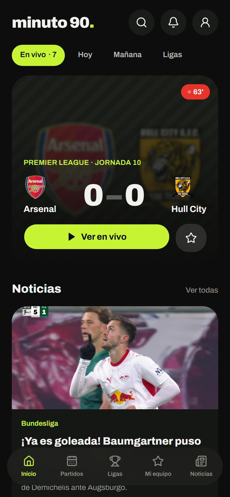
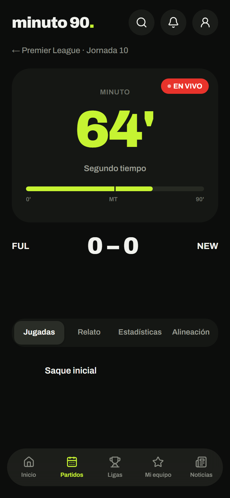
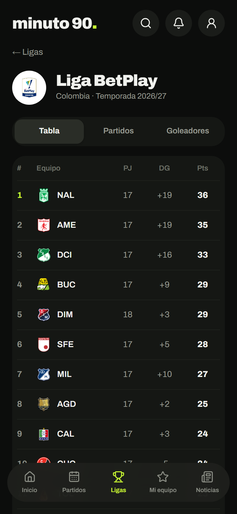
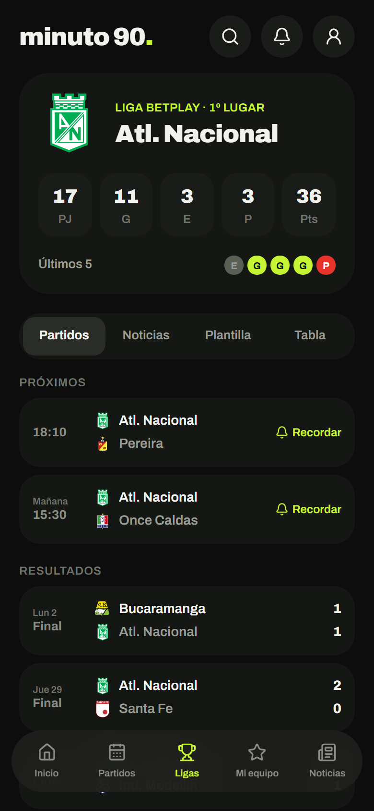
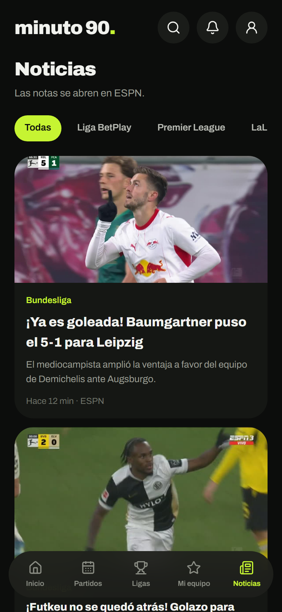
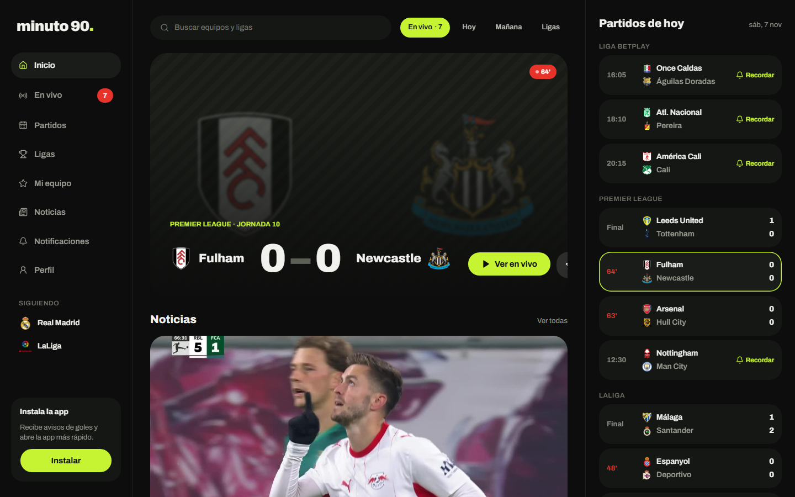
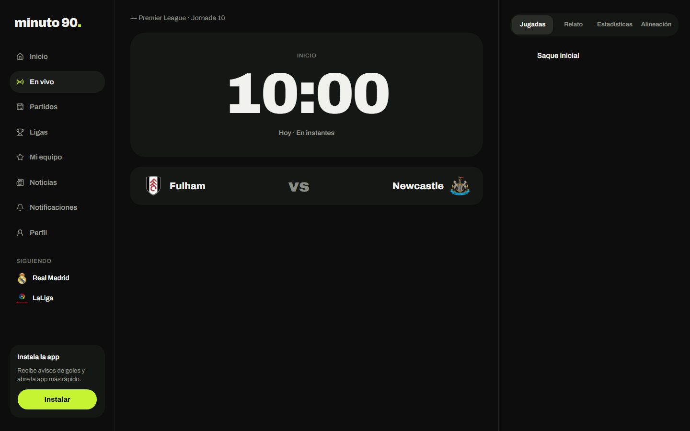

# Minuto 90 — PWA de fútbol

Next.js 16 (App Router) · React 19 · JavaScript (sin TypeScript) · Tailwind CSS v4 · shadcn/ui · Animate UI.
Interfaz "Estadio nocturno", responsive móvil / tablet / escritorio.

## Capturas

<table>
  <tr>
    <td align="center"><br><sub>Inicio</sub></td>
    <td align="center"><br><sub>Partido en vivo</sub></td>
    <td align="center"><br><sub>Liga BetPlay</sub></td>
  </tr>
  <tr>
    <td align="center"><br><sub>Equipo</sub></td>
    <td align="center"><br><sub>Noticias</sub></td>
    <td></td>
  </tr>
</table>




Las capturas se toman con la app corriendo (`npm run build && npm start`) y un navegador sin interfaz que emula un iPhone (390 px).

## Arrancar
Requiere Node 20.9 o superior.
```bash
npm install
npm run dev
```

## Firebase (login y datos de usuario)

1. En Firebase Console activa **Authentication → Correo/contraseña** y **Google**, y crea **Firestore**.
2. Copia `.env.example` a `.env` y llena los valores (Firebase, APIs de fútbol y Web Push). Sin las variables de Firebase el login queda desactivado.
3. Publica las reglas (una vez por cambio): `npx firebase-tools login` y luego `npx firebase-tools deploy --only firestore:rules`. El proyecto ya está en `.firebaserc`.

La estructura de la base de datos está documentada al inicio de `firestore.rules`.
Código en `src/lib/firebase/` (`auth.js`, `db.js`, `useUser.js`); pantalla de login en `/entrar`.

## Fuentes de datos

| Fuente | Para qué | Límite | Caché |
|---|---|---|---|
| **football-data.org** (oficial, gratis) | Ligas europeas, Libertadores y Brasileirão: partidos, tablas, goleadores, equipos | 10 consultas/min | partidos 1 min · tablas 1 h · equipos 1 día |
| **ESPN** (no oficial, sin clave) | Liga BetPlay, Argentina, Liga MX y MLS; minuto real; relato, eventos, estadísticas y alineaciones; noticias en español | No publicado | hoy 1 min · pasados 1 h · noticias 15 min |
| **API-Football** (oficial, gratis) | Respaldo del detalle de partido; plantillas con fotos; perfil de jugador | 100 consultas/día | 15 min a 30 días según el dato |

Las consultas se hacen en el servidor y su caché la comparten todos los usuarios. ESPN puede cambiar sin aviso: si falla, la app sigue con las otras dos.

## Dependencias
| Paquete | Tipo | Para qué |
|---|---|---|
| `next` | runtime | framework, rutas, `next/font`, caché de `fetch` |
| `react`, `react-dom` | runtime | UI |
| `firebase` | runtime | login (correo + Google) y Firestore |
| `tailwindcss`, `@tailwindcss/postcss` | dev | estilos (utilidades) |
| `shadcn`, `radix-ui`, `class-variance-authority`, `cn`, `tw-animate-css` | runtime | base de componentes shadcn/ui |
| `@animate-ui/react`, `motion` | runtime | animaciones de los componentes (Animate UI) |
| `lucide-react` | runtime | iconos |
| `eslint`, `eslint-config-next` | dev | `npm run lint` |

Sin librerías extra a propósito: los datos de la API se piden con `fetch` nativo desde el servidor
(route handlers / server components) usando la caché de Next (`revalidate`), así la API key nunca llega al navegador.
Rutas: `/` (Inicio), `/ranking`, `/admin` (solo admin), `/favoritos`, `/partido/[id]/sala/[sala]`, `/partidos`, `/partido/[id]`, `/ligas`, `/ligas/[id]`, `/equipo/[id]`, `/jugador/[id]`, `/mi-equipo`, `/noticias`, `/buscar`, `/notificaciones`, `/perfil`, `/entrar` y `/prueba` (solo desarrollo).
Pantallas de estado: `app/loading.js` (skeleton), `app/error.js`, `app/global-error.js` y `app/not-found.js` (404).

## Estructura
```text
src/
  styles/globals.css  ← TODO el tema: colores (variables shadcn + propias), radios, tamaños de texto, breakpoints
  theme/fonts.js      familias tipográficas (next/font)
  config/
    site.js           nombre de la app, descripción, colores PWA
    navigation.js     menú, filtros, "siguiendo"
  app/                rutas (layout, manifest, páginas)
  components/
    ui/               shadcn/ui (button, tabs, toggle-group, badge, progress, input, label…) + átomos propios (logo, media, team-crest…)
    layout/           app-shell, sidebar, bottom-nav, top-bar
    match/            componentes de fútbol (featured-match, match-list, match-tabs, scoreboard…)
    pwa/              install-card, service-worker
    league/           standings-table (tabla de posiciones y forma)
    auth/             login-form (entrar, registro, recuperar contraseña), profile-card (perfil y cerrar sesión)
    notifications/    bandeja de avisos y ajustes (push + preferencias)
  lib/
    api/matches.js    capa de datos (cámbiala por tu API)
    firebase/         auth, Firestore, useUser
    mocks/            datos de ejemplo
    push.js           Web Push en el navegador (suscribir, probar, desactivar)
    utils.js          cn() para unir clases
public/sw.js          service worker (red primero, cache de respaldo)
```

## Convenciones

- Una sola base: Tailwind + shadcn/ui. Sin CSS Modules.
- Un componente = un archivo en kebab-case con export con nombre: `import { Button } from '@/components/ui/button'`.
- Componentes nuevos de shadcn: `npx shadcn@latest add <nombre>` y luego `npx @animate-ui/cli@latest animate all` para animarlos.
- Iconos: usa los **animados** de `src/components/animate-ui/icons/` (Animate UI). Para agregar uno: `npx shadcn@latest add https://animate-ui.com/r/icons-lucide-<nombre>.json`. Solo si no existe animado, usa `lucide-react`.
- Microinteracciones: `Button` y `AnimatedLink` animan solos los iconos de adentro al pasar el cursor o tocar. Para listas usa `ENTER` + `stagger(i)` de `lib/utils.js`. Todo respeta "reducir movimiento" del sistema.
- No uses `npx shadcn add ... -o`: sobrescribe componentes ya personalizados (por ejemplo `button.jsx`).
- `'use client'` solo donde hay estado o eventos del navegador.
- Colores siempre con las clases del tema (`bg-card`, `text-primary`, `text-live`…), nunca hex sueltos en componentes.

## Tema

La app es solo oscura (`<html class="dark">`). Colores principales en `globals.css`:

| Variable | Uso | Clase |
|---|---|---|
| `--primary` | verde lima de la marca | `bg-primary`, `text-primary` |
| `--background` / `--card` / `--secondary` / `--accent` | fondo y superficies 1, 2, 3 | `bg-background`, `bg-card`… |
| `--muted-foreground` / `--subtle` / `--faint` | textos secundarios | `text-muted-foreground`, `text-subtle`, `text-faint` |
| `--live` | rojo "en vivo" | `bg-live`, `text-live` |

Para cambiar la marca: edita `--primary` en `globals.css`, la fuente en `fonts.js` y el nombre en `config/site.js`.

Breakpoints: `md` = 768px (tablet) y `xl` = 1200px (escritorio).

## Notificaciones

- **Bandeja** (`/notificaciones`): los avisos de tu cuenta, en tiempo real (Firestore).
- **Ajustes**: qué avisos quieres (goles, inicio, final, rojas, recordatorios, noticias de tu equipo) y activar push en el dispositivo.
- **Favoritos** (`/favoritos`): en la página de cualquier equipo toca la ★ **Agregar a favoritos** (máx. 50). De tus favoritos llegan los avisos.
  **Hacer mi equipo** elige el principal (el de `/mi-equipo`) y también lo agrega a favoritos.
- **iPhone:** push solo con iOS 16.4+ y la app instalada (Compartir → Agregar a inicio).
- **Aspecto de las notificaciones** (`public/sw.js` + `src/lib/notify/look.mjs`): escudo del equipo como ícono, imagen grande
  con el marcador al estilo de la app (`/api/push-image`, fuente Archivo en `src/assets/fonts`), badge blanco para la barra
  de Android (`/pwa-icon/badge`), vibración según el aviso (gol, roja, inicio, final), y botones **Ver partido** /
  **Silenciar partido** (`/api/push/mute`). Un aviso nuevo del mismo partido reemplaza al anterior y vuelve a sonar.
  iPhone solo muestra título y texto (Apple no permite imagen, botones ni badge).

### Avisos automáticos (goles, rojas, inicio, final y noticias de tu equipo)

Cada ~5 min, GitHub Actions llama a `/api/cron/notify`, que revisa los partidos y noticias de los equipos elegidos,
compara con lo ya avisado (`notifyState` en Firestore) y envía Web Push + guarda el aviso en la bandeja.
Lógica probada en `src/lib/notify/engine.mjs`. Para activarlo:

1. **Clave de servicio de Firebase:** Consola → Configuración del proyecto → Cuentas de servicio → *Generar nueva clave privada*.
   Pega el JSON (en una línea, o en base64) en `FIREBASE_SERVICE_ACCOUNT` (en `.env` y en Vercel). **Es secreta: nunca la subas al repo.**
2. **`CRON_SECRET`:** ya está en tu `.env.local`; cópiala a Vercel.
3. **GitHub → Settings → Secrets and variables → Actions:** crea `APP_URL` (tu URL de Vercel) y `CRON_SECRET` (el mismo valor).
4. Publica las reglas de Firestore (cambiaron): `npx firebase-tools deploy --only firestore:rules`.
5. Prueba a mano: pestaña **Actions → Avisos automáticos → Run workflow**.

GitHub puede retrasar las tareas programadas unos minutos; los avisos de gol llegan con hasta ~5–10 min de demora.

## Salas de partido

En un partido en vivo o por empezar, **Crear sala** (requiere sesión) abre `/partido/[id]/sala/[sala]`.
- **Invitar:** el botón comparte el enlace (WhatsApp, etc.) o lo copia. El id de la sala es aleatorio y es la invitación.
- **Dentro:** marcador, minuto y las **animaciones de cada momento** (cada miembro las ve al llegar el evento) + chat en tiempo real.
- **Chat:** 1 mensaje cada 60 s por persona y hasta 200 caracteres. Lo hacen cumplir las **reglas de Firestore**
  (no se puede saltar desde el navegador). El autor borra sus mensajes; el creador, cualquiera, y puede cerrar la sala.
- La sala cierra 6 h después de creada. Nadie puede listar salas ajenas.
- **Probar las reglas:** `npm run test:rules` (emulador de Firestore; necesita Java 11+, nunca toca la base real).
- **Publica las reglas** después de actualizar: `npx firebase-tools deploy --only firestore:rules`.

## Animaciones de momentos clave

Gol, gol de último minuto (desde el 88'), amarilla, roja, doble amarilla, VAR y final, a pantalla completa sobre la app.
Usan **GSAP** y **anime.js**, que se descargan solo en el navegador. Respetan "reducir movimiento" (pasan a banner), vibran en el celular,
tienen sonido (botón para silenciar) y se saltan con un toque.

- `src/lib/moments/engine.js` — motor (sin React) · `map-event.mjs` — eventos de la app → momentos (probado).
- `<MomentsProvider>` en `app/layout.js` · `<LiveMoments match={match} />` en la página del partido: anima cada evento **nuevo** que llega.
  Al entrar a un partido **en vivo**, lo que ya pasó no se anima (sale un toast con el marcador); en uno terminado sí se repasa todo.
- **Jugadas del relato como toast** (`<PlayToasts>`, lógica en `play-toasts.mjs`): faltas, fueras de lugar, córners, tiros a puerta,
  mano, penales, cambios y juego detenido, mientras miras un partido en vivo. Vienen del tipo de jugada del relato de ESPN.
- Pruébalas en `/prueba`: panel con cada animación (pantalla completa o banner) y el partido simulado que las dispara.

## Ligas que sigues

En `/ligas` (o en la página de cada liga) toca **Seguir**. En Inicio y Partidos solo salen los partidos de las ligas que sigues;
si no sigues ninguna, se ven todas. Se guarda en `users/{uid}.follows.leagues`.

## Puntos, racha y ranking

Los da **solo el servidor** (rutas `/api/game/*` con firebase-admin), así no se pueden falsear desde el navegador. Valores en `src/lib/game/rules.mjs` (probado):

| Acción | Puntos |
|---|---|
| Entrar al app (1 vez por día, hora de Colombia) | +10 · racha +1 (se pierde si pasa un día sin entrar) |
| 7 días seguidos | +50 de bono |
| Leer una noticia | +3 (máx. 5 noticias al día) |
| Votar quién gana (hasta que empiece el partido) | +5 |
| Acertar el ganador | +20 (lo da la tarea programada al terminar el partido) |

Racha y puntos en la cabecera (llama) y en `/ranking` (top 50). Requiere `FIREBASE_SERVICE_ACCOUNT` y el índice de `firestore.indexes.json`.

## Panel de admin (`/admin`)

Solo para la cuenta de `ADMIN_EMAIL` (correo verificado); cualquier otra ve 404. Muestra los usuarios (alta, última vez, puntos)
y las **peticiones al servidor por día** de cada uno (páginas, navegación y `/api`, sin estáticos ni precargas), de los últimos 14 días.
El conteo lo hace `src/proxy.js` (una escritura en Firestore por petición, en `usage/{día}`); el servidor sabe quién pide por la cookie
`m90_token` (token de Firebase que la app renueva sola). Requiere `FIREBASE_SERVICE_ACCOUNT` y `ADMIN_EMAIL` en Vercel.

## Partido de prueba (animaciones)

`npm run dev` y abre **http://localhost:3000/prueba**. Simula un partido en vivo sin usar las APIs:
iniciar, medio tiempo, final, y botones para gol, amarilla, roja, cambio, VAR y penal fallado de cada equipo.
El modo automático corre el reloj (1 minuto de juego = 1 s, 0,5 s o 0,2 s) y genera eventos al azar.
Usa los mismos componentes que un partido real, así que toda animación nueva se ve aquí.
En producción da 404 salvo que definas `ENABLE_TEST_MATCH=1`. Motor y pruebas: `src/components/test-match/`.

## Desplegar (Vercel) y probar en el celular

1. En [vercel.com](https://vercel.com) → **Add New → Project** → importa el repo `futbolapp`. Detecta Next.js solo.
2. En **Environment Variables** agrega las mismas variables de tu `.env` y `.env.local`:
   `API_FOTBALL_API_KEY`, `API_FOTBALL_API_HOST`, `API_DATA_API_KEY`, `API_DATA_API_HEADER`,
   las 7 `NEXT_PUBLIC_FIREBASE_*`, `NEXT_PUBLIC_VAPID_PUBLIC_KEY`, `VAPID_PRIVATE_KEY`, `VAPID_SUBJECT`,
   `FIREBASE_SERVICE_ACCOUNT`, `CRON_SECRET` y `ADMIN_EMAIL`.
   (Opcional: `ENABLE_TEST_MATCH=1` para abrir `/prueba` en producción.)
3. **Deploy**. Cada `git push` a `main` vuelve a desplegar.
4. En Firebase → **Authentication → Configuración → Dominios autorizados**, agrega tu dominio de Vercel (`tu-app.vercel.app`); si no, el login con Google falla.
5. Publica las reglas de Firestore (ver la sección Firebase).
6. En el teléfono abre la URL de Vercel:
   - **Android (Chrome):** menú ⋮ → **Instalar app**.
   - **iPhone (Safari):** Compartir → **Agregar a inicio**, y ábrela desde el ícono (así funcionan las notificaciones).

## PWA
- `app/manifest.js` genera `/manifest.webmanifest`.
- Iconos generados por código: `app/pwa-icon/[size]` (192, 512 y maskable) y `app/apple-icon.js` (iOS). Usan `logoMark` de `config/site.js`.
- El service worker solo se registra en producción (`npm run build && npm start`).
